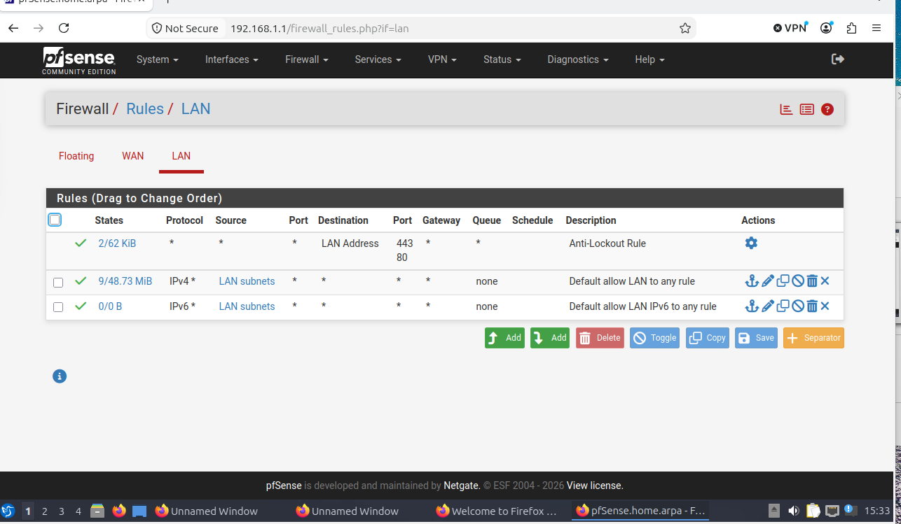
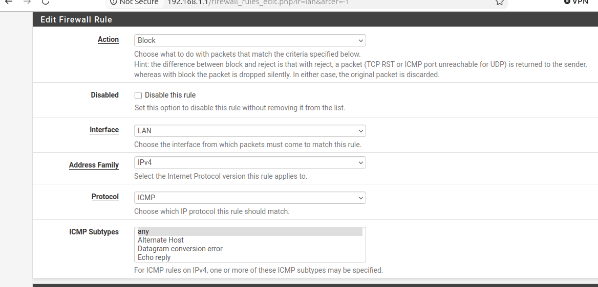
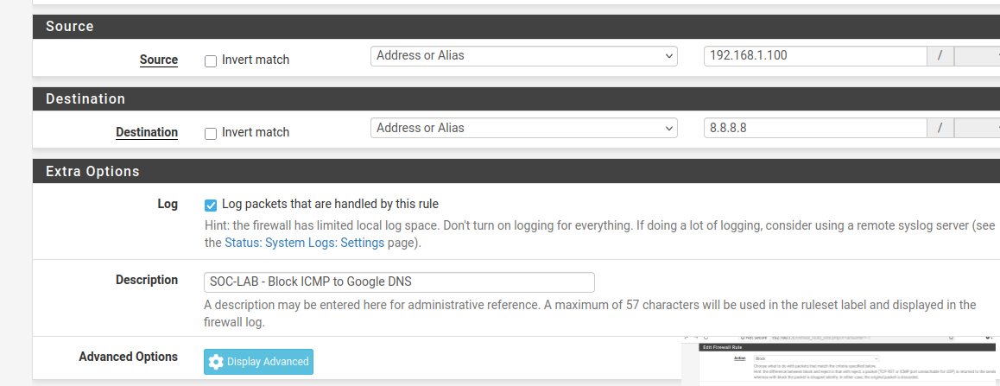
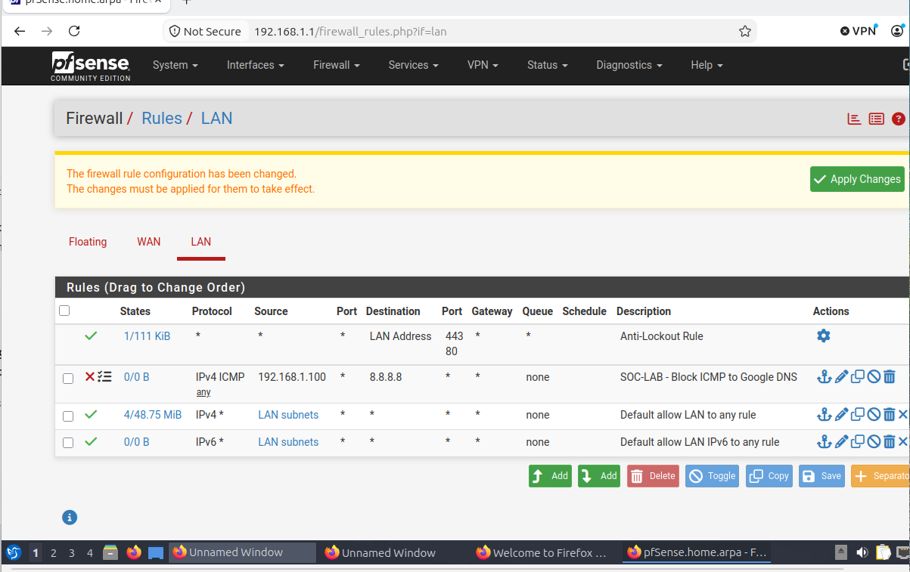
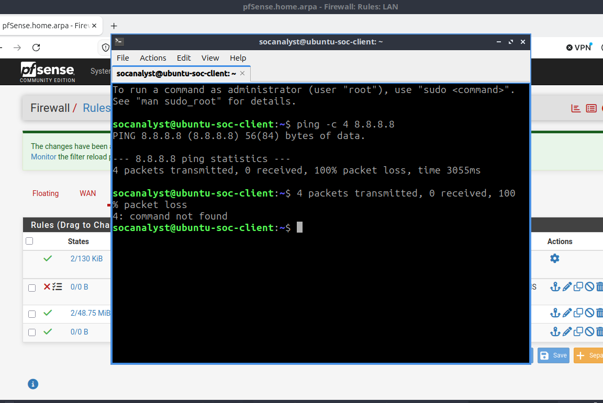
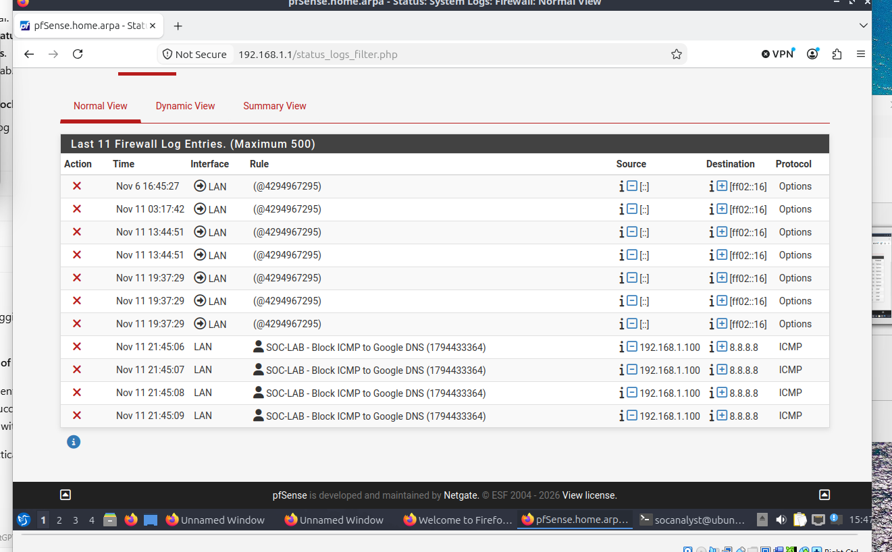
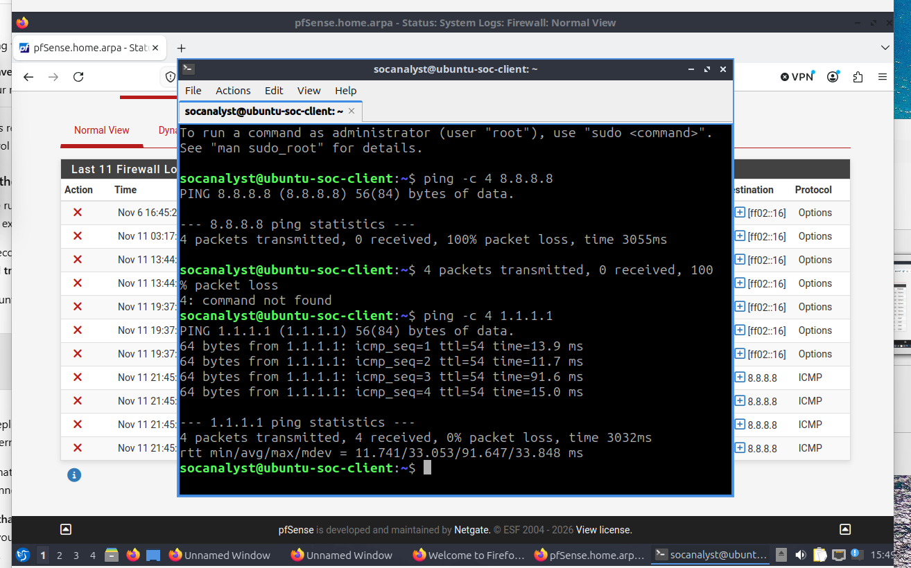

# Phase 2 — Firewall Rules and Security Control Validation

**Project:** pfSense Firewall Security Lab  
**Date:** November 11, 2026  
**Environment:** Oracle VirtualBox · pfSense Community Edition 2.9.0 · Lubuntu 24.04 LTS  
**Lab network:** SOC-LAB (isolated VirtualBox internal network on the LAN side)

## Objective

Implement a narrowly scoped firewall policy that blocks ICMP traffic from a Linux SOC workstation to one external IPv4 address, while allowing traffic to other destinations. Validate the policy with command-line tests and firewall logs.

## Lab topology

```text
Lubuntu SOC client (192.168.1.100)
       |
       | VirtualBox internal network: SOC-LAB
       v
pfSense LAN (192.168.1.1/24)
       |
       | pfSense WAN via VirtualBox NAT
       v
External test destinations: 8.8.8.8 and 1.1.1.1
```

## Firewall policy

| Parameter | Configuration |
|---|---|
| Action | Block |
| Interface | LAN |
| Address family | IPv4 |
| Protocol | ICMP (any subtype) |
| Source | 192.168.1.100 (single host) |
| Destination | 8.8.8.8 (single host) |
| Logging | Enabled |
| Rule description | SOC-LAB - Block ICMP to Google DNS |
| Rule priority | Above default IPv4 LAN allow rule |

The existing anti-lockout and default allow rules were preserved. This exercise blocks **ICMP to 8.8.8.8**, not all Google DNS traffic or DNS queries generally.

## Method and observed results

1. **Baseline:** Before the block rule was applied, `ping -c 4 8.8.8.8` returned four replies and 0% packet loss (observed earlier in the lab session).
2. **Configuration:** Created a LAN IPv4 ICMP Block rule for source `192.168.1.100` and destination `8.8.8.8`, with packet logging enabled.
3. **Activation:** Saved the rule, confirmed its placement above the default allow rule, and clicked **Apply Changes**.
4. **Denied-traffic test:** Re-ran `ping -c 4 8.8.8.8`; result: **4 transmitted, 0 received, 100% packet loss**.
5. **Log verification:** In **Status → System Logs → Firewall**, found **four blocked ICMP entries** from `192.168.1.100` to `8.8.8.8`, attributed to the named SOC-LAB rule.
6. **Allowed-traffic test:** Ran `ping -c 4 1.1.1.1`; result: **4 transmitted, 4 received, 0% packet loss**.

## Evidence

| Screenshot | Evidence |
|---|---|
|  | Existing LAN policy and rule order before modification |
|  | Block action, LAN interface, IPv4 and ICMP selection |
|  | Source/destination targeting, logging and description |
|  | New rule placed above default LAN allow rule; screenshot captured before applying changes |
|  | ICMP test to 8.8.8.8 after activation: 100% packet loss |
|  | Four blocked ICMP events associated with the custom rule |
|  | ICMP to 1.1.1.1 remained reachable: 0% packet loss |

## Analysis and security implications

- **Least-privilege targeting:** The restriction applies to a specific source, protocol and destination rather than blocking the entire LAN.
- **Rule order:** pfSense evaluates matching interface rules in order, so the block must precede the broader allow rule.
- **Control effectiveness:** The failed ping alone could have multiple causes; corresponding firewall log entries provide stronger evidence that the configured rule enforced the block.
- **Availability:** Successful ICMP replies from `1.1.1.1` demonstrate that the policy did not prevent all outbound ICMP traffic.
- **Monitoring:** Logging creates an audit trail that can support SOC investigations and GRC control testing.

## Limitations and next steps

This was a controlled functional test, not a penetration test or proof of complete network isolation. ICMP filtering does not establish that TCP/UDP or DNS traffic to `8.8.8.8` is blocked. Potential follow-up exercises include rule disable/re-enable testing, DNS traffic controls, additional logging, and documenting rollback procedures.

## Skills demonstrated

pfSense administration · firewall rule ordering · network access controls · Linux CLI testing · ICMP analysis · security log review · control validation · technical documentation
