# pfSense Virtual Firewall & Network Security Lab

**Status:** Phase 1 and Phase 2 complete — pfSense deployment, network configuration, firewall rule testing, ICMP traffic validation, and firewall log analysis.
## Objective
Build an isolated virtual network for hands-on firewall administration, network segmentation, DHCP, and security-log analysis. This project documents the initial deployment of a pfSense Community Edition firewall in Oracle VirtualBox.

## Environment
| Component | Configuration |
|---|---|
| Host | Windows mini PC, 16 GB RAM, 256 GB SSD |
| Hypervisor | Oracle VirtualBox |
| Firewall | pfSense CE 2.9.0 (FreeBSD amd64) |
| VM resources | 2 vCPU, 2048 MB RAM, ~16 GB virtual disk |
| WAN adapter | `em0`, VirtualBox NAT, DHCP, observed `10.0.2.15/24` |
| LAN adapter | `em1`, VirtualBox Internal Network `SOC-LAB`, `192.168.1.1/24` |
| LAN DHCP scope | Configured during installation: `192.168.1.100–192.168.1.199` (client lease test pending) |
| Storage | ZFS, stripe (single virtual disk), GPT |

## Network architecture
```text
Internet / host Wi-Fi
       |
VirtualBox NAT
       |
 pfSense em0 (WAN): 10.0.2.15/24
       |
 pfSense firewall
       |
 pfSense em1 (LAN): 192.168.1.1/24
       |
 VirtualBox Internal Network: SOC-LAB
       |
Lubuntu SOC Client VM: 192.168.1.100/24 (deployed and tested)
```

## Deployment walkthrough
1. Created a FreeBSD (64-bit) VM with two virtual network adapters and attached the Netgate installer ISO. See [VM configuration](screenshots/01-virtualbox-config.png).
2. Configured WAN `em0` to use DHCP via VirtualBox NAT. See [WAN mode](screenshots/02-wan-mode.png).
3. Configured LAN `em1` as static `192.168.1.1/24`, with DHCP enabled and a `.100–.199` scope. See [LAN settings](screenshots/03-lan-settings.png).
4. Verified interface assignments (`em0` WAN, `em1` LAN). See [assignments](screenshots/04-interface-assignment.png).
5. Selected ZFS/GPT on the 16 GB virtual disk and selected pfSense CE 2.9.0. See [version selection](screenshots/05-installer-version.png).
6. Downloaded and installed pfSense packages. See [installation progress](screenshots/06-installation-progress.png).
7. Confirmed installation completion, removed the installer ISO, and restarted the VM from its virtual hard drive. See [installation completion](screenshots/07-installation-complete.png).
8. Verified the running pfSense console showed WAN `10.0.2.15/24` and LAN `192.168.1.1/24`. See [running console](screenshots/08-firewall-console.png).

## Troubleshooting: installer could not reach Netgate servers
**Symptom:** The network-based installer repeatedly displayed “Cannot reach the Netgate Servers.”

**Checks performed:** Confirmed the Windows host could browse the web; verified VirtualBox WAN adapter used NAT and had its virtual cable connected; verified the WAN interface was set to DHCP.

**Change tested:** Changed the installer WAN option **Use local resolver** from `false` to `true`. A subsequent attempt progressed to subscription validation and package downloads.

**Interpretation:** The resolver change correlated with successful connectivity. The exact root cause was not conclusively isolated, so this should not be presented as a universally proven fix.

**Boot issue:** After unmounting the ISO, the installer environment could not execute `reboot` (`Device not configured`). A VirtualBox reset successfully booted the installed system.

## Evidence and validation
- [x] pfSense CE installation completed
- [x] VM booted from installed virtual disk
- [x] WAN interface obtained a DHCP address
- [x] LAN interface displayed its configured static address
- [ ] Confirm LAN DHCP lease from a client VM
- [ ] Access pfSense web dashboard from a client on `SOC-LAB`
- [ ] Demonstrate allowed and blocked traffic with firewall rules
- [ ] Collect and interpret firewall logs

## Next steps
1. Create a lightweight Linux client VM on the `SOC-LAB` Internal Network.
2. Verify DHCP lease, gateway, DNS, and connectivity.
3. Open pfSense web UI from the Linux client; change default admin credentials and document baseline settings.
4. Implement test firewall rules, record expected versus observed outcomes, and collect logs.
5. Add sanitized screenshots and a findings section to this repository.

## Security notes
This is a lab environment. Do not expose the pfSense management interface directly to the public internet. Before publishing new screenshots, review them for public IPs, credentials, tokens, and other sensitive data. The addresses in this report are private RFC1918 addresses.

## Skills demonstrated
Virtualization, firewall deployment, WAN/LAN interface assignment, DHCP planning, ZFS installation, network troubleshooting, and technical documentation.


## Installation Screenshots

The following screenshots document the deployment and configuration of the pfSense virtual firewall.

### 1. VirtualBox Configuration
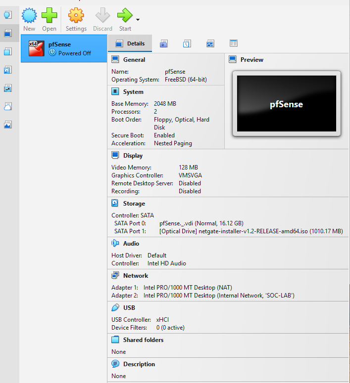

### 2. WAN Network Configuration
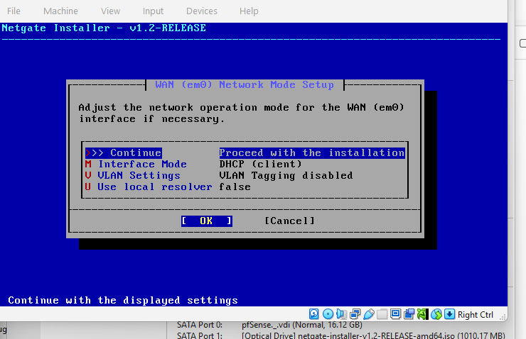

### 3. LAN Network Configuration
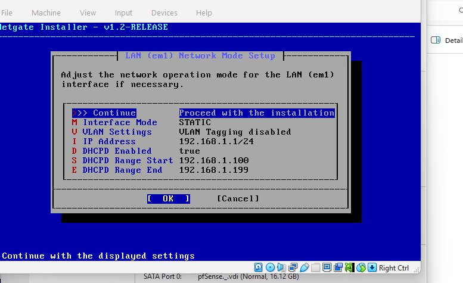

### 4. Interface Assignment
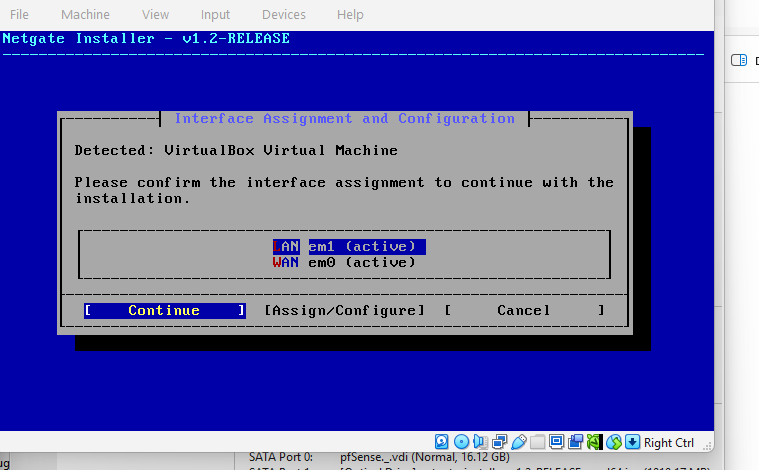

### 5. pfSense Version Selection
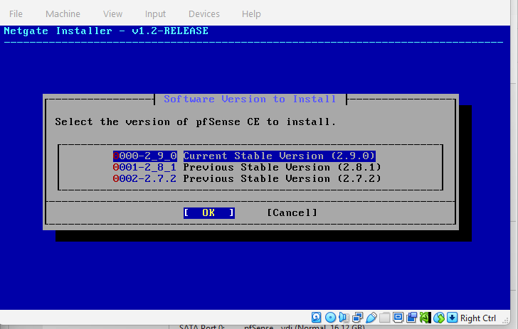

### 6. Installation Progress
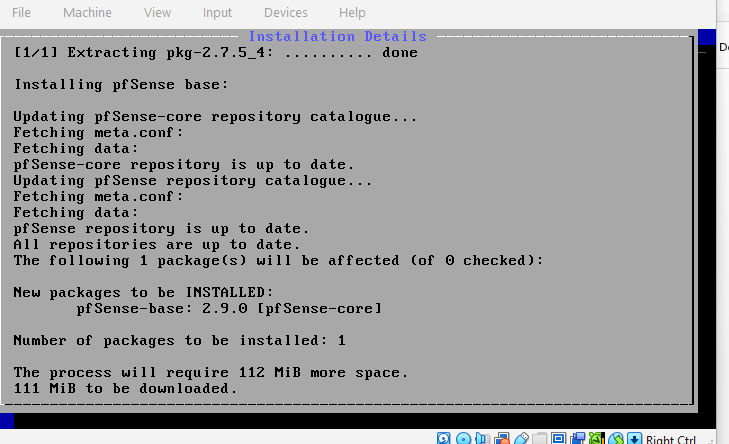

### 7. Installation Complete
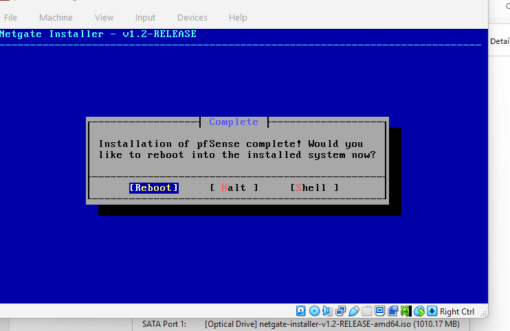

### 8. Operational Firewall Console
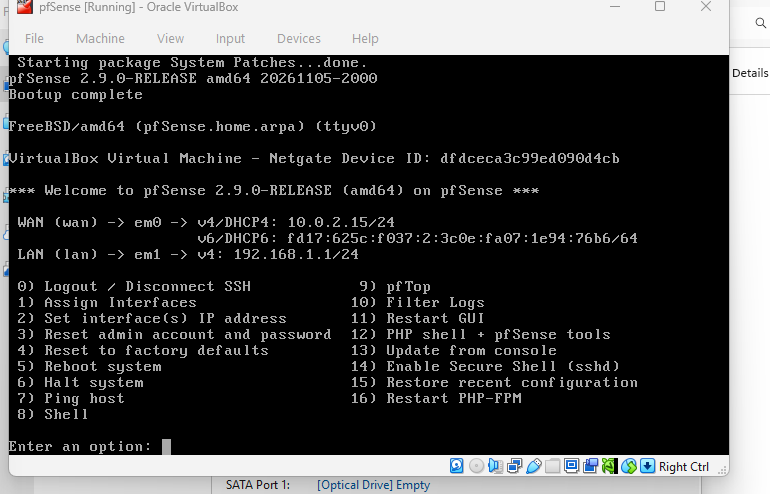
## Phase 2 — Firewall Rules and Traffic Validation

The following screenshots document firewall rule configuration, ICMP traffic testing, and log validation.

### 1. Default LAN Firewall Rules
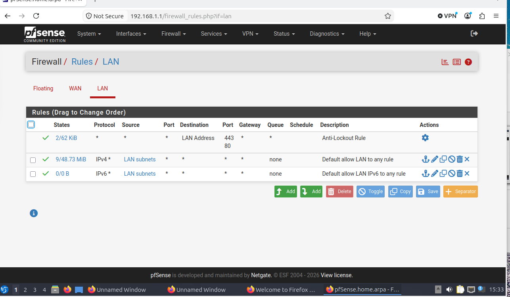

### 2. Firewall Rule Action and Protocol
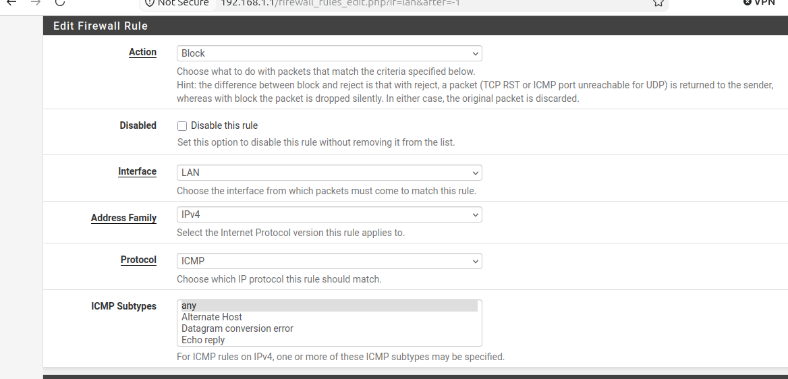

### 3. Source, Destination, and Logging
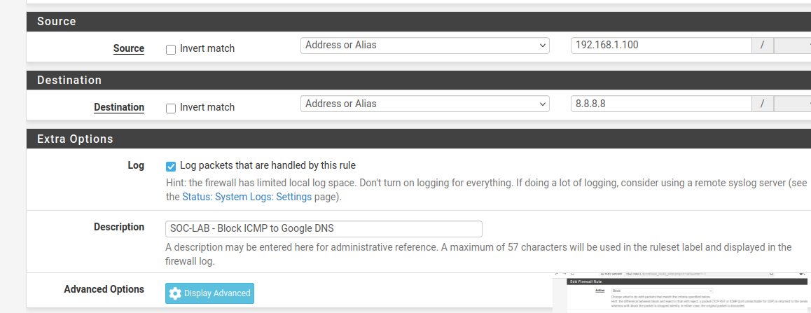

### 4. Firewall Rule Saved
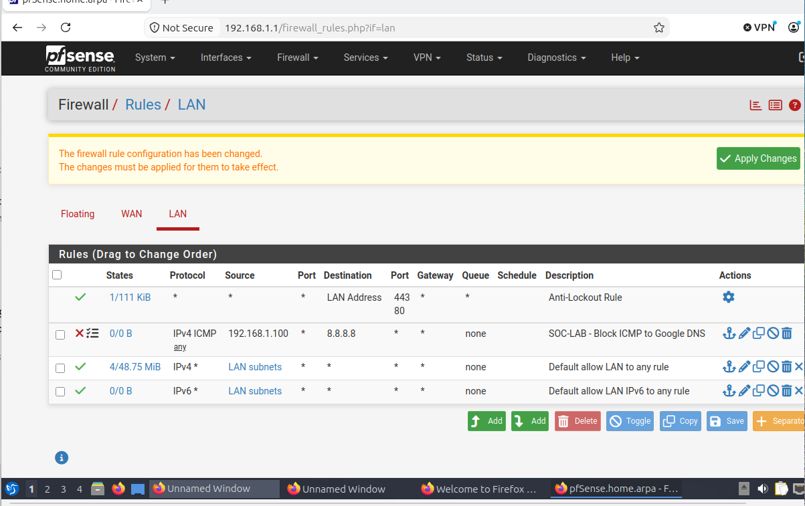

### 5. Blocked ICMP Traffic
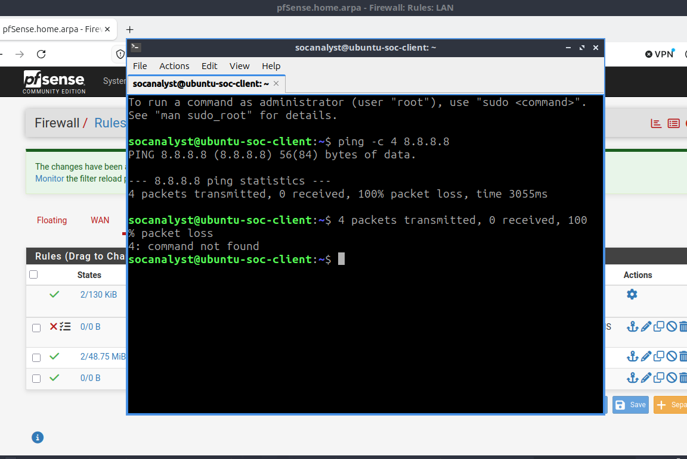

### 6. Firewall Block Logs
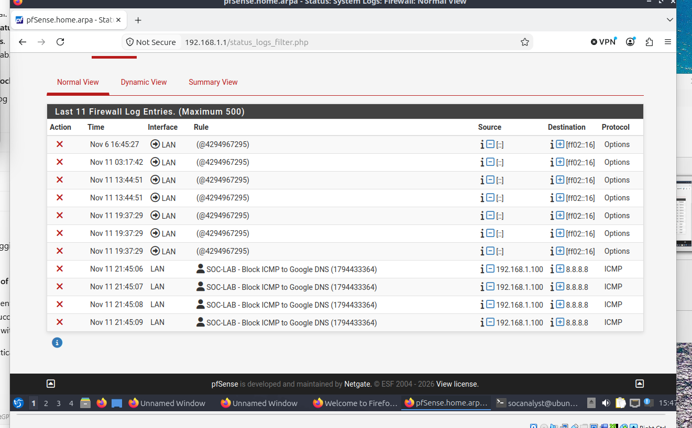

### 7. Allowed ICMP Traffic
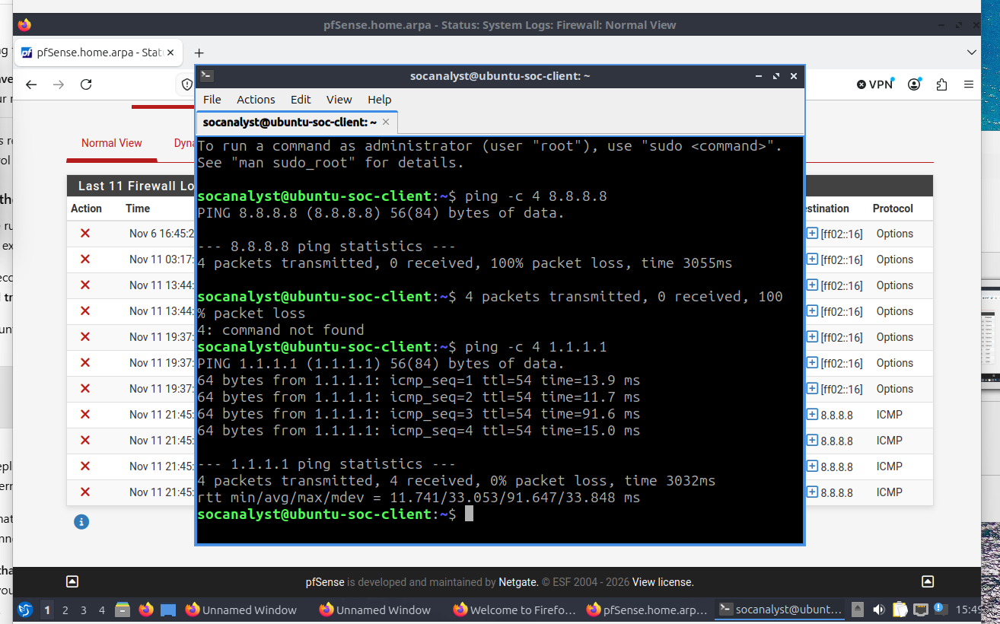
